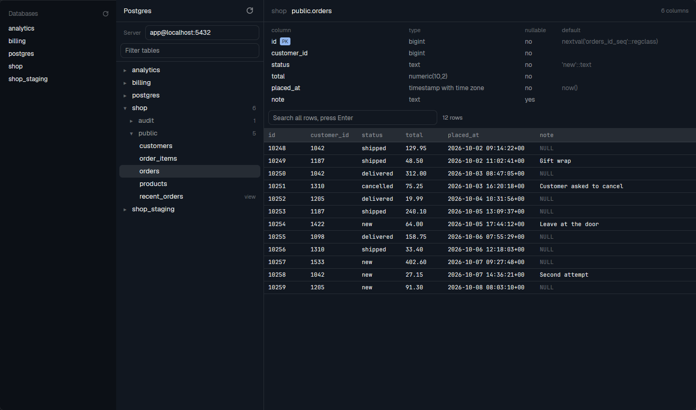

# Postgres Browser, a Herdr mod

A read-only browser for a Postgres server, for the [Herdr](https://herdr.dev) app. Browse the
databases and tables, see the columns and the first rows of a table, and search all rows. A small
list of databases for the sidebar opens the browser with one click.

Current release: [v0.1.0](https://github.com/tedeling/herdr-postgres/releases/tag/v0.1.0).



## Install

You need `psql` on your computer.

```
git clone https://github.com/tedeling/herdr-postgres.git
cp -r herdr-postgres/mods/pg ~/.config/herdr-app/mods/
herdr-app do tab.new --mod pg --name Postgres
```

To open it with a key, merge `keys.json` into your `~/.config/herdr-app/keys.json`. It binds
`ctrl-shift-y` and `cmd-shift-y`.

## Connect

Type the server in the **Server** box as `user@host:port` and press Enter. The default is
`localhost:5432`. The value stays on your computer, in the Herdr state and not in the mod files.

Do not type a password in the box. The mod never asks for a password, and `psql` reads it from
`~/.pgpass`:

```
localhost:5432:*:myuser:mypassword
```

The file must have the mode 600 (`chmod 600 ~/.pgpass`), or `psql` ignores it.

## Copy a value

Click a cell in the table rows to select it, then press **Ctrl+C** (or **Cmd+C** on macOS).
The selected cell is highlighted, and a brief "Copied" notification confirms the copy.
Copying preserves line breaks and tabs and includes text hidden by the column width, up to the
browser's 500-character limit per value. NULL copies as
`NULL`. Press **Esc** to clear the selection.

## The list for the sidebar

Herdr does not dock a mod in a shipped layout. To get the list, clone a layout with `layout.clone`
and add this block to its `sidebar-lists` column:

```json
{ "id": "databases", "type": "block", "content": { "mod": "pg", "props": { "view": "panel" } }, "size": { "px": 262 }, "min": 90 }
```

## What it can do on your server

Each session is read-only (`default_transaction_read_only=on`), and each statement stops after 10
seconds. The mod sends only `select` statements. A row search scans the full table, so be careful
on a large production table.

[RECIPE.md](RECIPE.md) is the brief to build this mod from scratch. To run the tests, use
`node --test mods/pg/`.

## License

[MIT](LICENSE).
