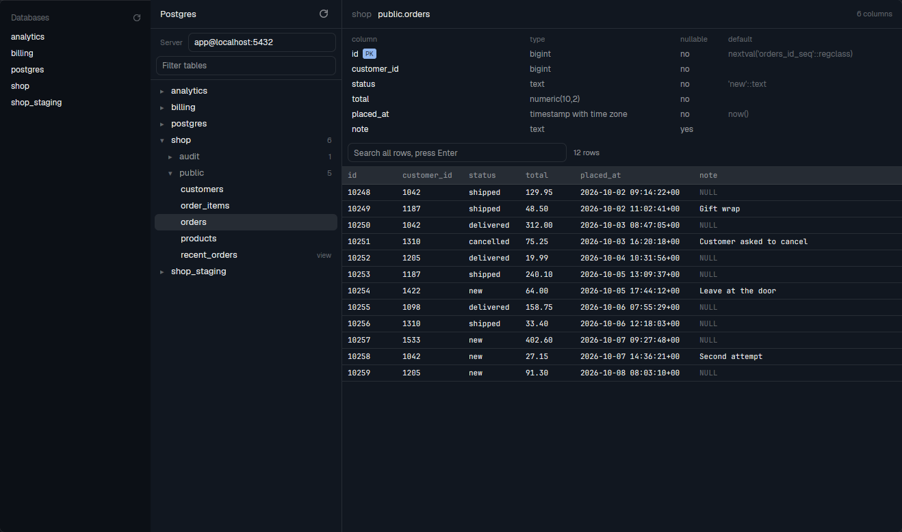

# Postgres Browser

A read-only browser for a Postgres server, in a Herdr tab. On the left you see the databases of
the server, folded into schemas and tables. Pick a table to see its columns and its first 50 rows,
and search all rows of the table. Click a row cell and press Ctrl+C or Cmd+C to copy its value,
with a brief confirmation. A second view is a small list of databases for the sidebar. A click
on a database in that list opens the browser for that database.

## What you see

### The browser

One row on the `background` color, base type 13px.

**The left column** is 280px wide, with a 1px `border` on the right. Top to bottom:

- **Header**, 42px tall, 14px side padding, a 1px `border` below. The word "Postgres" in semibold
  on the left. On the right a 24px square button, radius 6, with `mods/pg/refresh.svg` at 14px in
  `muted`. The button has the tooltip "Load again" and the `hover` background under the pointer.
  The icon spins once every 900 ms while a load runs.
- **Boxes**, 8px side padding, 6px vertical padding, 6px gap, a 1px `border` below:
  - A row with the word "Server" (11px, `dim`) and a text box. The placeholder is
    `user@host:port`, and the box holds the current server.
  - While the server box has the keyboard, a line in 11px `dim`: "Enter connects. Esc cancels."
  - After a bad value, a line in 11px `ansi1`: "Use user@host:port, for example
    app@localhost:5432."
  - A text box with the placeholder "Filter tables".
  - Each box is 28px tall, radius 7, 8px side padding, 12px type. Its 1px border is `border`,
    and `accent` while the box has the keyboard.
- **Status**: "Loading databases…" in `dim`, or a server error in 11px `ansi1`, with 14px padding.
- **The list**, 6px side padding and 4px vertical padding, with a scrollbar. All rows are 24px
  tall, radius 6, 8px right padding, 6px gap:
  - A database: 8px left padding, a chevron (▸ or ▾, 11px, `dim`), the name in semibold. An open
    database shows its table count on the right (11px, `dim`).
  - A schema: 20px left padding, a chevron, the name in `muted`, the table count.
  - A table: 38px left padding, the name, and on the right `view`, `matview` or `foreign` for
    these kinds (10px, `dim`). The selected table has the `selected` background.
  - A note: 38px left padding, 11px, "Loading tables…" in `dim` or an error in `ansi1`.
  - Rows that can open or select have the `hover` background under the pointer.

**The right side** fills the rest. With no table it shows "Pick a table on the left", centered, in
`dim`. With a table, top to bottom:

- **Header**, 42px tall, 14px side padding, a 1px `border` below: the database in `dim`, then
  `schema.table` in semibold, then the kind if it is not a plain table. On the right, "6 columns"
  in 11px `dim`.
- **Columns**, 22px rows, 12px type, a 1px `border` below. The height is `(columns + 1) * 22 + 8`
  and at most 220px, and the block scrolls. The headers are `column`, `type`, `nullable` and
  `default` (11px, `dim`). The widths are 260, 220, 70 and the rest. A primary key column shows a
  `PK` badge (9px, `accent_foreground` on `accent`, radius 3). The type and nullable values are
  `muted`, and the default value is `dim`.
- **Search**, 40px tall, 8px side padding, a 1px `border` below: a 320px text box with the
  placeholder "Search all rows, press Enter". Next to it in 11px `muted`: "Loading…", "12 rows",
  "first 50 rows", "1 row", "no rows", "3 matches", "first 50 matches" or "no matches".
- **Error**, only after a failure: 11px `ansi1`, 14px side padding, 6px vertical padding.
- **Rows**, in the terminal font from `settings().font_family` (else "JetBrains Mono") at 11px.
  They scroll in both directions. The header is 26px tall on `raised`, in semibold `muted`. Each
  row is 24px tall with a 1px `border` below. Each cell has 8px side padding and truncates. NULL
  shows as the word `NULL` in `dim`. The width of a column is `longest value * 7 + 20`, from 80px
  to 360px. Cells have the `hover` background under the pointer, and a selected cell has the
  `selected` background.

### The list for the sidebar

One column on `chrome` with a 1px `border` above:

- **Header**, 41px tall, 14px above, 5px below, 16px left, 10px right. The word "Databases" at
  11.5px, medium, `dim`. On the right a 20px square button, radius 5, with `mods/pg/refresh.svg` at
  12px in `dim`. The icon spins while a load runs.
- **Error**, only after a failure: 11px `ansi1`, 16px side padding, 4px vertical padding.
- **The list**, 8px side padding, scrolls. Each row is 24px tall, 8px side padding, radius 6, 12px
  type, one truncated database name, `hover` under the pointer.

When the sidebar is narrower than 160px (the rail), the block draws only its background and its
top line.

## How it behaves

- It shows no agent statuses. The only motion is the refresh icon.
- **The server.** The default is `localhost:5432`. A value has the form `user@host:port`, and the
  user and the port are optional. With no user, `psql` picks the user. With no port, the port is
  5432. The host can be a socket folder. Enter in the server box saves a good value with
  `setShared("pg.server", text)`, so the value persists and is the same in all copies. Esc puts the
  current value back.
- **A server change.** All copies follow when they draw again. A browser copy clears its state and
  loads the databases. A list copy empties and loads again.
- **Passwords.** The mod runs `psql -w`, which never asks for a password. A password comes from
  `~/.pgpass`. Without one, the error is "The server needs a password. Add it to ~/.pgpass."
- **Read-only.** Each session has `default_transaction_read_only=on`,
  `statement_timeout=10000` and `connect_timeout=5`. After 10 seconds, the error is "The query
  stopped after 10 seconds." The mod sends only `select` statements.
- **The list.** A click on a database opens or folds it, and the first open loads its tables. A
  database with one schema shows it open. With more schemas, each schema starts folded. A click on
  a table selects it, clears the row search and loads the columns and the rows. A newer load makes
  the answer of an older load worthless, so a late answer never replaces a newer one.
- **The filter** acts on each key. All words must occur in `schema.table`, with no difference for
  case. While a filter is active, all schemas show open.
- **The row search** runs on Enter, on all rows of the table, not only the rows on screen. It uses
  `column::text ilike '%term%'` on every column, with `%`, `_` and `\` escaped.
- **The rows.** At most 50 rows, in primary key order when the table has a primary key. A cell
  holds at most 500 characters, and line breaks and tabs show as one space.
- **Copy a value.** Clicking a row cell selects it and gives the keyboard to the view. Ctrl+C or
  Cmd+C copies its original loaded value, including line breaks, tabs and text hidden by the
  column width. A success notification says "Copied" for one second after the clipboard is
  written. NULL copies as `NULL`, and an empty string copies as empty text. Inputs keep
  their own copy behavior. Selection clears when a table or row load starts and when rows are
  replaced. Cells cannot be selected while a load runs.
- **Esc** empties the filter or the search box, puts the server box back, and gives the keyboard
  back to the view. If a row search was active, the rows load again with no search. With no box
  focused, Esc clears the selected cell.
- **Load again** loads the databases, the tables of each open database and the selected table.
- **The list for the sidebar.** A click looks in the shown space for a tab named
  `pg: <database>`. If that tab exists, the click selects it. If not, the click runs `tab.new` with
  that name, the mod `pg` and `props: { database }`, and that database starts open in the new tab.
  The list loads once and on its refresh button. It does not poll.
- **Other errors.** The first line of the `psql` error shows, without the prefix `psql: error:`,
  `ERROR:` or `FATAL:`. If `psql` cannot start, the error is "Could not start psql. Install the
  PostgreSQL client."

## Built from

- A mod folder `mods/pg/`, with `{ "place": "none", "title": "Postgres" }` in `mod.json`.
  - `logic.js`: all rules, with no app imports, so `node --test` can run them.
  - `main.js`: the view that Herdr starts, and the `psql` calls.
  - `panel.js`: the list for the sidebar, as a plain class that `main.js` draws.
  - `refresh.svg`: a 24×24 line icon of a circular arrow.
- Props: `{ view: "panel" }` selects the list for the sidebar. `{ database }` starts the browser
  with that database open. With neither, it is the browser with all databases folded.
- Open the browser with `tab.new {mod: "pg", name: "Postgres"}`. The optional `keys.json` binds
  this to `ctrl-shift-y` and `cmd-shift-y`.
- Add the list to a personal layout with this block. The `sidebar-lists` column of a clone of
  `main` is a good place:
  `{ "id": "databases", "type": "block", "content": { "mod": "pg", "props": { "view": "panel" } }, "size": { "px": 262 }, "min": 90 }`
- From `herdr`: `exec`, `layout`, `notify`, `props`, `run`, `setShared`, `settings`, `shared`, `spaces`,
  `theme`. Commands: `tab.new`, `tab.select`.
- From `gpui-base`: `v_flex`, `h_flex`, `InputState`, `Input`, `Scrollbar`, `v_virtual_list`.
- One program: `psql`, always as
  `psql -X -w --csv -P null=<<NULL>> -d <conninfo> -c <sql>`. The conninfo quotes each value that a
  person can type. Each call is a new connection.
- The queries:
  - Databases, through the database `postgres`:
    `select datname from pg_database where datallowconn and not datistemplate order by datname`.
  - Tables: `pg_class` joined to `pg_namespace`, kinds `r`, `p`, `v`, `m`, `f`, without
    `pg_catalog`, `information_schema`, `pg_toast%` and `pg_temp%`.
  - Columns: `pg_attribute` with `pg_attrdef` and the primary key from `pg_index`.

## Watch out

- The app refuses an import from another mod folder ("resolves outside the application
  directory"). This is why the list for the sidebar is a view of this mod, and not a second mod.
- The first argument of `init(props, cx)` does not hold the props in herdr-app 0.1.13. Use
  `props()` from `herdr`.
- `cx.notify()` throws during `render`, and `cx.spawn` starts its body at once. To react to a
  shared value in `render`, start with `await cx.sleep(0)` in the spawned body.
- A row in a virtual list must not call `on_click`. Use one `on_item_click((key, cx) => ...)` on
  the list. `herdr-app check` does not run those rows, and the error goes to the journal.
- A server can have hundreds of tables, so the list must stay a virtual list with one row height.
- `InputState.set_value` sends no change event, so set the state yourself after a call.
- `exec` has a limit of 30 seconds and 8 MiB. The statement limit and the 50 rows stay below it.
- Herdr does not dock a mod in a shipped layout, so the list for the sidebar needs a personal
  layout.
- Limits: the server text has no IPv6 form and no password, on purpose. The database `postgres`
  must allow a connection, because the database list uses it. A text value that is exactly
  `<<NULL>>` shows as NULL.

## Done when

- `node --test mods/pg/` passes, and `herdr-app check mods/pg` reports no problem.
- With no server on the configured port, the browser and the list show "Connection refused" in the
  error color, and no other failure occurs.
- With `user@host:port` in the server box and Enter, the databases of that server show, and they
  still show after a restart of the app.
- Without a password in `~/.pgpass`, the error names `~/.pgpass`.
- A table shows its columns with a `PK` badge and its first 50 rows in primary key order.
- Clicking a row cell highlights it, and Ctrl+C or Cmd+C copies its loaded value. Copying from
  an input still copies the input's selection. Esc and reloading clear the cell selection.
- A search finds a value in a row that was not on screen, and Esc brings all rows back.
- A statement that takes more than 10 seconds stops with the planned message.
- With a block in a personal layout, a click on a database in the list opens a tab named
  `pg: <database>` with that database open. A second click goes to the same tab.
